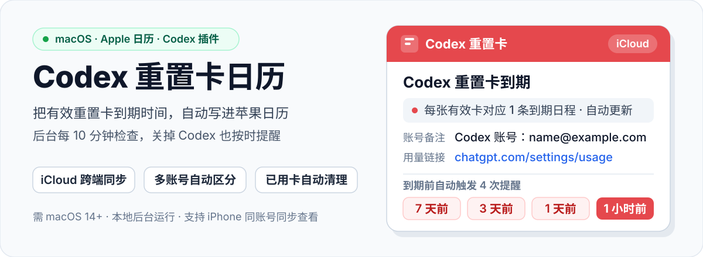
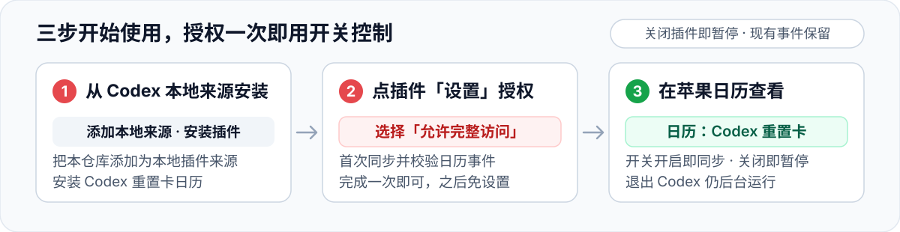

<p align="center">
  
</p>

一个运行在 Mac 本地的 Codex 插件：自动读取有效重置卡的到期时间，同步到 **iCloud 苹果日历** 并提前发提醒，避免重置卡悄悄过期。安装时授权一次，**之后只用插件开关控制**，退出 Codex 也能后台运行。

---

## 怎么用

<p align="center">
  
</p>

### 1. 安装并授权（只需一次）

把仓库放在打算长期保留的位置，再在 Codex 中把它添加为**本地插件来源**，安装 **Codex 重置卡日历**。也可以直接对 Codex 说：

```text
帮我把这个仓库作为本地插件来源添加，安装 Codex 重置卡日历插件，然后打开它的「设置」完成安装
```

安装后，在插件里点一次 **「设置」**。macOS 弹出提示时，选择 **允许完整访问**。设置完成后，插件会自动同步卡片并校验日历事件。

> **使用前提**：macOS 14+、已安装 Xcode Command Line Tools、Codex 已登录 ChatGPT、Mac 已开启 iCloud 日历。iPhone 使用同一 Apple 账户并开启 iCloud 日历同步即可一起收到提醒。\
> 若 Codex 中暂未显示该插件，重启 ChatGPT 桌面 App 即可。

### 2. 日常只用插件开关

- **开启插件**：马上同步一次；之后每 10 分钟检查一次。
- **关闭插件**：停止新的同步；不会读取卡片、不会发起新的日历写入，已有的日历事件照常保留。已经交给 macOS 日历助手的写入可能仍会完成。
- **退出 Codex**：后台同步继续运行，不受 Codex 是否打开影响。

打开苹果日历，查看 **Codex 重置卡** 日历即可看到到期提醒。

---

## 它会自动做什么

- **开关即时响应**：从关闭（或状态未知）变为开启时立即同步一次，无关的设置改动不会提前触发同步，也不会打乱 10 分钟周期。
- **每 10 分钟静默检查**：开启状态下按正常周期同步；休眠或离线自动跳过，恢复后继续。
- **到期前 4 次提醒**：默认设在到期前 **7 天、3 天、1 天、1 小时**（首次同步不补发已错过的提醒；距到期不足 1 小时时改为前 5 分钟或到期时）。
- **多账号互不覆盖**：日程备注会写入当前账号完整邮箱；切换账号后，新卡标注新账号，旧账号日程照常保留。Codex 未返回可确认的账号时，插件会跳过本次同步。
- **已用卡自动清理**：获取到完整卡片清单后，自动移除已用卡片的未来提醒，历史记录继续保留。
- **失败自动重试**：同步失败时按固定间隔重试，不会因一次失败永久停止。

---

## 日常管理

- **查看同步状态 / 排错**：在 Codex 新对话里直接说「`查看 Codex 重置卡日历的同步状态`」。
- **暂停或恢复同步**：用插件开关即可，说明见上文「日常只用插件开关」。

## 数据与权限

插件使用本机已登录的 Codex 读取卡片，使用 macOS 日历助手写入「Codex 重置卡」iCloud 日历。请在 macOS 系统设置中开启 Apple 的 iCloud 日历，并避免将其他 CalDAV 账号命名为「iCloud」。日程备注包含完整邮箱，共享该日历时，共享对象也可以看到备注。账号信息和同步状态保存在项目目录之外。

---

<details>
<summary>开发者维护与测试</summary>

插件源码位于 `plugins/codex-reset-calendar/`。后台程序存放在 Mac 的应用支持目录。Codex 需要保留已登记的本地插件来源，才能确认插件开关。

后台每 2 秒轮询一次 Codex 配置以感知开关变化；关闭或状态未知时不会每 2 秒启动 Codex，配置变化会立即重新检查。

修改源码后可在项目根目录运行测试。更新时先让 Codex 从本地来源安装新版，确认版本后，再点一次插件的「设置」。

```sh
/usr/bin/python3 -B -m unittest discover -s tests
```

内部 `--marketplace` 参数供开发或旧版本迁移使用。

</details>

## 许可证

本项目使用 [MIT 许可证](LICENSE)。
